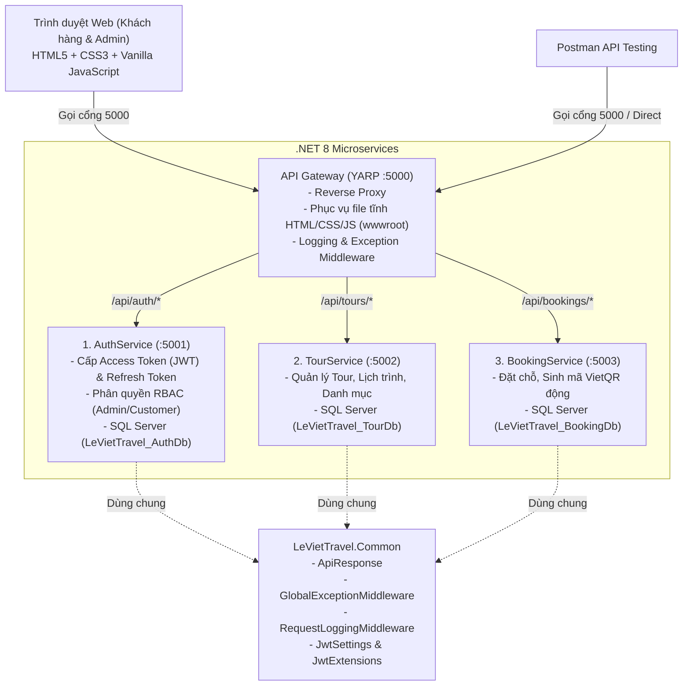

# LeViet Travel - Hệ Thống Microservices ASP.NET Core 8.0

Dự án đã được thiết kế và triển khai hoàn chỉnh theo mô hình **Microservices với ASP.NET Core 8.0, C#, API Gateway (YARP), JWT Authentication, Refresh Token Rotation, Middleware tùy biến, Phân quyền RBAC, SQL Server và Giao diện Web bằng HTML, CSS, JavaScript**.

---

## 1. Kiến Trúc Tổng Thể Hệ Thống



---

## 2. Cấu Trúc Thư Mục Source Code

```text
LeViet_Travel/
├── LeVietTravel.slnx                             # Solution chứa toàn bộ các project C#
├── src/
│   ├── Common/
│   │   └── LeVietTravel.Common/                 # Thư viện dùng chung (Middleware, JWT, ApiResponse, Roles)
│   ├── Gateway/
│   │   └── LeVietTravel.ApiGateway/             # API Gateway (YARP) cổng 5000
│   │       └── wwwroot/                         # Giao diện Web HTML, CSS, JavaScript
│   │           ├── index.html                   # Trang chủ khách hàng: Tìm, xem và đặt tour
│   │           ├── admin.html                   # Trang quản trị viên: Quản lý tour, đơn hàng, test RBAC
│   │           ├── css/style.css                # Giao diện CSS hiện đại, responsive
│   │           └── js/
│   │               ├── api.js                   # Xử lý gọi API, JWT, tự động Refresh Token
│   │               └── app.js                   # Xử lý logic hiển thị dữ liệu
│   └── Services/
│       ├── AuthService/                         # Microservice Xác thực & Phân quyền (cổng 5001)
│       ├── TourService/                         # Microservice Quản lý Tour (cổng 5002)
│       └── BookingService/                      # Microservice Đặt chỗ & VietQR (cổng 5003)
├── database/
│   └── Create_Database_SqlServer.sql            # Script tạo Database & Bảng trong SQL Server
├── postman/
│   ├── LeViet_Travel_Microservices.postman_collection.json  # File Collection Postman
│   └── LeViet_Travel_Environment.postman_environment.json   # File Môi trường Postman
├── run_microservices.bat                        # Script 1-click khởi chạy toàn bộ hệ thống
└── stop_microservices.bat                       # Script 1-click tắt toàn bộ hệ thống
```

---

## 3. Các Thành Phần Trọng Tâm Đã Triển Khai

### 3.1. C# & ASP.NET Core 8.0 Microservices
- Tách biệt độc lập thành 3 business services (`AuthService`, `TourService`, `BookingService`) và 1 `ApiGateway`.
- Mỗi service có Database Context riêng biệt, cấu hình cổng riêng và có Swagger UI riêng.

### 3.2. API Gateway (YARP Reverse Proxy)
- Dự án sử dụng **YARP (Yet Another Reverse Proxy)** - thư viện chính thức của Microsoft cho .NET 8.
- Chạy trên cổng `http://localhost:5000`, tự động định tuyến:
  - `/api/auth/{**catch-all}` ➔ `http://localhost:5001`
  - `/api/tours/{**catch-all}` ➔ `http://localhost:5002`
  - `/api/bookings/{**catch-all}` ➔ `http://localhost:5003`

### 3.3. JSON Web Token (JWT) & Phân Quyền (RBAC)
- Khởi tạo token với các Claims: `NameIdentifier` (UserId), `Email`, `Name` (FullName), `Role` (`ADMIN` hoặc `CUSTOMER`).
- Phân quyền bằng attribute `[Authorize(Roles = Roles.Admin)]`.
- Có API test phân quyền:
  - `GET /api/auth/admin-only` (Chỉ tài khoản Role `ADMIN` mới được phép truy cập, Customer truy cập sẽ nhận `403 Forbidden`).
  - `GET /api/auth/customer-only` (Dành cho Role `CUSTOMER`).

### 3.4. Refresh Token Rotation (Xoay Vòng Token)
- Bảng `RefreshTokens` trong cơ sở dữ liệu lưu trữ token mã hóa 64-byte an toàn, hạn dùng 7 ngày, kèm `RevokedAt` và `ReplacedByToken`.
- Endpoint `POST /api/auth/refresh-token`:
  - Khi Access Token hết hạn, client gửi `refreshToken`.
  - Hệ thống thu hồi token cũ, cấp mới cả **Access Token** lẫn **Refresh Token mới**.
- Endpoint `POST /api/auth/revoke-token`: Cho phép đăng xuất và thu hồi Refresh Token ngay lập tức.
- Trong giao diện JavaScript (`wwwroot/js/api.js`), hàm `apiFetch()` tự động bắt lỗi `401 Unauthorized`, gọi `/refresh-token` ngầm và retry lại request ban đầu mà người dùng không bị gián đoạn.

### 3.5. Middleware Tùy Biến (Custom Middlewares)
1. **`GlobalExceptionMiddleware`**: Bắt mọi ngoại lệ chưa được xử lý trong pipeline, ghi log và trả về định dạng chuẩn `ApiResponse.Fail(500, ...)`, chống lộ thông tin nhạy cảm của máy chủ.
2. **`RequestLoggingMiddleware`**: Tự động đo thời gian phản hồi (latency), ghi log method HTTP, đường dẫn URL và status code của từng request.

### 3.6. SQL Server & Entity Framework Core
- Cấu hình chuẩn kết nối Microsoft SQL Server qua `Microsoft.EntityFrameworkCore.SqlServer`.
- Hỗ trợ cơ chế tự động khởi tạo (`DbInitializer.Initialize(context)`) và có script SQL tạo bảng thủ công `database/Create_Database_SqlServer.sql`.
- Tích hợp tính năng tự động chuyển sang In-Memory Database khi máy chưa bật dịch vụ SQL Server để đảm bảo hệ thống luôn khởi động thành công ngay lập tức khi chấm bài hoặc demo.

### 3.7. Giao Diện HTML, CSS, JavaScript (wwwroot)
- **Website khách hàng (`index.html`)**:
  - Tìm kiếm và lọc tour du lịch theo từ khóa và danh mục.
  - Đăng ký và Đăng nhập (có nút điền nhanh tài khoản Admin/Customer mẫu).
  - Đặt tour du lịch, tự động tính tổng tiền theo số người lớn và trẻ em.
  - Tự động sinh mã VietQR chuyển khoản ngân hàng trực tiếp.
  - Xem danh sách lịch sử đơn đặt chỗ ("Đơn Đặt Của Tôi") và hủy đơn.
- **Trang Quản trị viên (`admin.html`)**:
  - Bảng thống kê số tour, đơn hàng, đơn chờ duyệt, tổng doanh thu.
  - Nút **"Kiểm Tra Quyền RBAC"** trực quan kiểm tra quyền Admin qua API.
  - Quản lý danh sách tour (thêm mới tour, xóa tour).
  - Quản lý đơn đặt chỗ (Duyệt thanh toán đơn đặt tour).

---

## 4. Hướng Dẫn Chạy Hệ Thống

### Cách 1: Chạy bằng file Batch (Nhanh nhất)
1. Nhấp đúp chuột vào file **`run_microservices.bat`**.
2. Hệ thống sẽ mở 4 cửa sổ command chạy lần lượt:
   - Cổng 5001: `AuthService`
   - Cổng 5002: `TourService`
   - Cổng 5003: `BookingService`
   - Cổng 5000: `ApiGateway` & Giao diện Web
3. Trình duyệt sẽ tự động mở trang web tại địa chỉ: **`http://localhost:5000`**.
4. Khi muốn tắt, nhấp đúp file **`stop_microservices.bat`**.

### Cách 2: Chạy bằng dòng lệnh `dotnet`
Mở 4 tab terminal tại thư mục gốc của dự án:
```bash
# Tab 1: Khởi động AuthService
dotnet run --project src/Services/AuthService/LeVietTravel.AuthService/LeVietTravel.AuthService.csproj --urls=http://localhost:5001

# Tab 2: Khởi động TourService
dotnet run --project src/Services/TourService/LeVietTravel.TourService/LeVietTravel.TourService.csproj --urls=http://localhost:5002

# Tab 3: Khởi động BookingService
dotnet run --project src/Services/BookingService/LeVietTravel.BookingService/LeVietTravel.BookingService.csproj --urls=http://localhost:5003

# Tab 4: Khởi động API Gateway & Web Frontend
dotnet run --project src/Gateway/LeVietTravel.ApiGateway/LeVietTravel.ApiGateway.csproj --urls=http://localhost:5000
```

---

## 5. Tài Khoản Thử Nghiệm Mẫu

Hệ thống đã nạp sẵn 2 tài khoản mẫu:

| Tài khoản | Email | Mật khẩu | Quyền (Role) | Chức năng kiểm thử |
|---|---|---|---|---|
| **Quản trị viên (Admin)** | `admin@leviet.com` | `Admin@123` | `ADMIN` | Truy cập `admin.html`, thêm/xóa tour, duyệt đơn booking, gọi API `/api/auth/admin-only` (Thành công `200`). |
| **Khách hàng (Customer)** | `an@example.com` | `Password123` | `CUSTOMER` | Đặt tour, xem đơn cá nhân, gọi API `/api/auth/admin-only` (Bị chặn `403 Forbidden`). |

---

## 6. Hướng Dẫn Test API Bằng Postman

1. Mở ứng dụng **Postman**.
2. Nhấn nút **Import** ở góc trên bên trái:
   - Chọn file `postman/LeViet_Travel_Microservices.postman_collection.json`.
   - Chọn file `postman/LeViet_Travel_Environment.postman_environment.json`.
3. Ở góc trên bên phải màn hình Postman, chọn Environment là **`LeViet Travel (Microservices - .NET 8)`**.
4. Thực hiện chạy thử các request theo thứ tự:
   - **Request 1.2 `1.2 Đăng nhập Admin`**: Bấm **Send**. Postman Script sẽ **tự động lưu `accessToken` và `refreshToken`** vào biến môi trường!
   - **Request 1.4 `1.4 Lấy thông tin cá nhân (Get Me)`**: Bấm **Send**, hệ thống sử dụng Bearer token vừa lưu để trả về thông tin Admin.
   - **Request 1.6 `1.6 Kiểm tra quyền Admin (RBAC: Admin Only)`**: Bấm **Send**, nhận kết quả thành công `200 OK`.
   - **Request 1.3 `1.3 Đăng nhập Khách hàng`**: Bấm **Send**, token chuyển sang tài khoản Customer. Sau đó gọi lại Request 1.6 bạn sẽ thấy mã lỗi **`403 Forbidden`** (chứng minh tính năng phân quyền RBAC hoạt động chính xác).
   - **Request 1.5 `1.5 Gia hạn Token (Refresh Token Rotation)`**: Bấm **Send**, hệ thống tự động xoay vòng cấp cặp Access Token và Refresh Token mới.
   - **Nhóm 2 (Tour Service) & Nhóm 3 (Booking Service)**: Test các API lấy danh sách, đặt tour, duyệt đơn.
